<div align="center">
  
  <h1>ScholarFlow</h1>
  <p>
    <strong>Local-first academic workspace for tasks, PDFs, knowledge search, and evidence-grounded active recall.</strong>
  </p>
  <p>
    <a href="https://github.com/Markism-JA/ScholarFlow/releases/latest">
      
    </a>
    
    
    
  </p>
  <p>
    <a href="#in-action">In Action</a> ·
    <a href="#feature-tour">Feature Tour</a> ·
    <a href="#quick-install--uninstall">Quick Install</a> ·
    <a href="#architecture">Architecture</a> ·
    <a href="#keyboard-shortcuts">Shortcuts</a> ·
    <a href="docs/LMS_PROVIDER_INTEGRATION.md">LMS Plugins</a>
  </p>
</div>

<br />

<p align="center">
  <picture>
    <source media="(prefers-color-scheme: dark)" srcset="docs/images/hero-dark.png" />
    <source media="(prefers-color-scheme: light)" srcset="docs/images/hero-light.png" />
    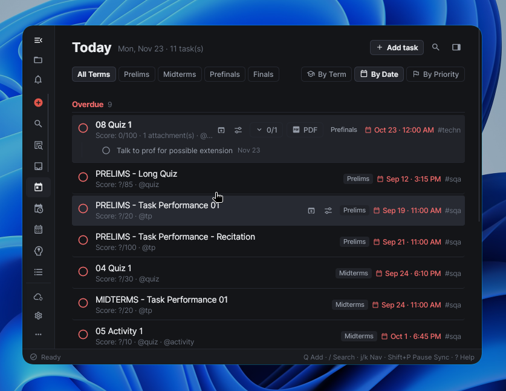
  </picture>
</p>

---

## Why ScholarFlow?

- **Local-First & Portable Vault:** Tasks, mastery history, and full-text search indexes live in a fast SQLite + FTS5 database (`.scholarflow/scholarflow.db`) alongside your local PDFs, code files, and Markdown study notes—with one-way Markdown export whenever you want a readable snapshot.
- **Evidence-Grounded Active Recall:** Every quiz question cites the exact page and verbatim passage from your source material. Click a citation to jump straight to the highlighted sentence inside the built-in PDF Reader.
- **Works Standalone or with an LMS:** Use ScholarFlow completely offline with local courses and textbooks, or connect an LMS plugin (bundled with **STI eLMS / CYPHER** via `ScholarFlow.Elms.Sti`) to sync deadlines, handouts, and announcements automatically.
- **Model-Agnostic AI + 100% Offline Fallback:** Bring your own OpenAI-compatible provider (Google AI Studio, OpenAI, OpenRouter, DeepSeek, Groq, Ollama, LM Studio, or custom endpoints), use the zero-API Manual JSON Bridge, or generate quizzes offline with the built-in PDF analyzer.

---

## In Action

### Evidence-Grounded Quiz → Instant PDF Highlight Jump
Answer questions with rendered Mermaid diagrams, LaTeX math, or cropped PDF figures, then click any evidence citation to jump directly to the highlighted passage in a 1,100+ page textbook.

<p align="center">
  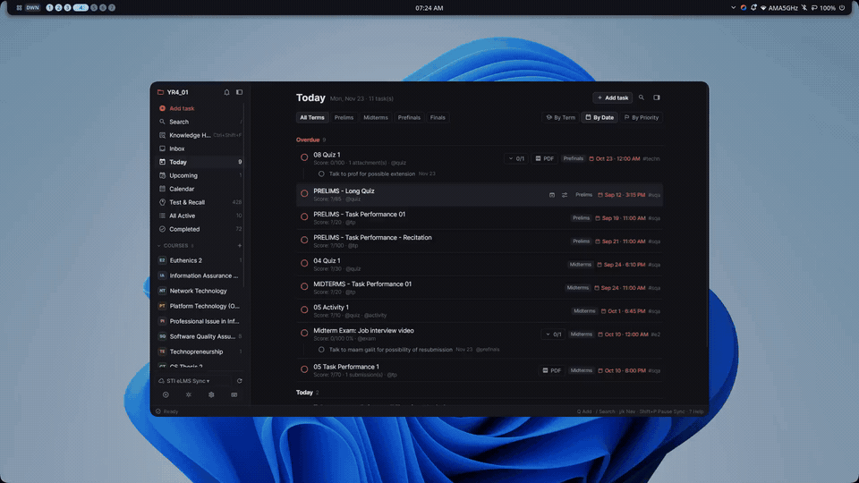
</p>

### Knowledge Hub Spotlight Search (`Ctrl+Shift+F`)
Query across every indexed PDF, code file, Markdown note, and saved quiz with SQLite FTS5 ranking, weak-spot boosting, and one-click `Quiz This` generation.

<p align="center">
  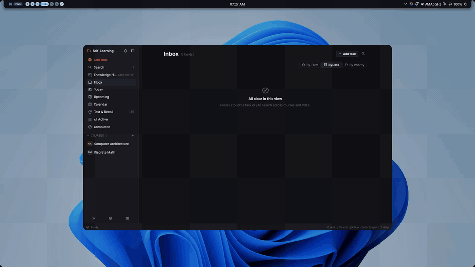
</p>

---

## Feature Tour

### 1. Evidence-Grounded Quiz Studio & Printable Exams
- **Rich Question Modalities:** Generate **Code** snippets, **Math (LaTeX)** via `CSharpMath.SkiaSharp` with numeric equivalence grading, **Mermaid Diagrams** via pure-.NET `Mermaider` + `Svg.Skia`, and auto-extracted **PDF Source Figures** (including uncaptioned pure-vector charts).
- **Learning-Science Engine:** Mix `Multiple Choice`, `Identification`, `Situational`, `Ordering`, `True/False`, and `Fill in the Blank` with cognitive-depth blueprints, Quality Critic checks, 3-layer zero-token JSON recovery, and SM-2/FSRS interleaved review.
- **Printable Exam & Study Guide Export:** Export clean, exam-ready PDFs with assessment blueprints, structured rationales (`Why Correct`, `Why Distractors Fail`, `Core Principle`), verbatim citations, and embedded rendered Mermaid diagrams & source figures.

<table>
  <tr>
    <td width="50%" valign="top">
      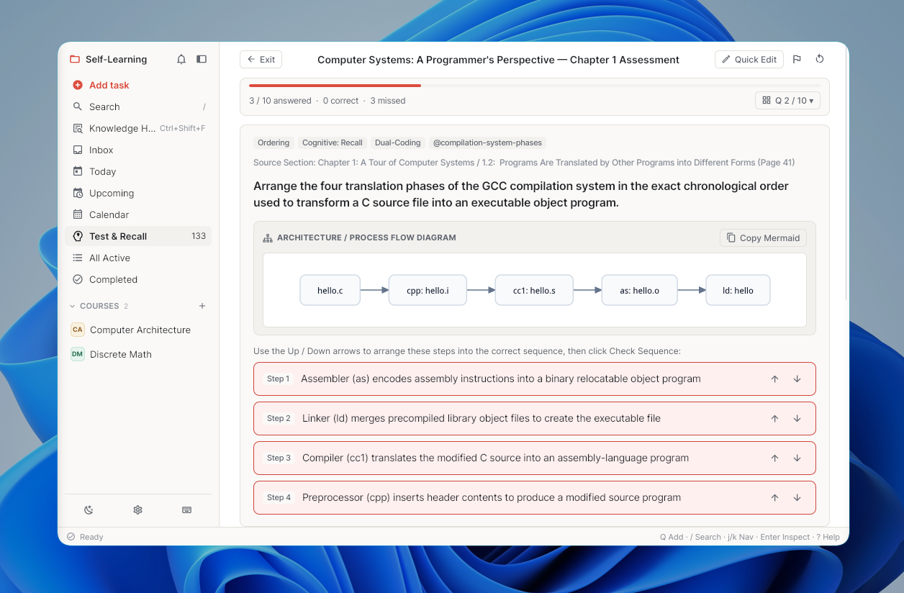<br />
      <sub><b>Quiz Play Window</b> — Native Mermaid diagram rendering, Question Map, Quick Edit (<code>E</code>), and cognitive tags.</sub>
    </td>
    <td width="50%" valign="top">
      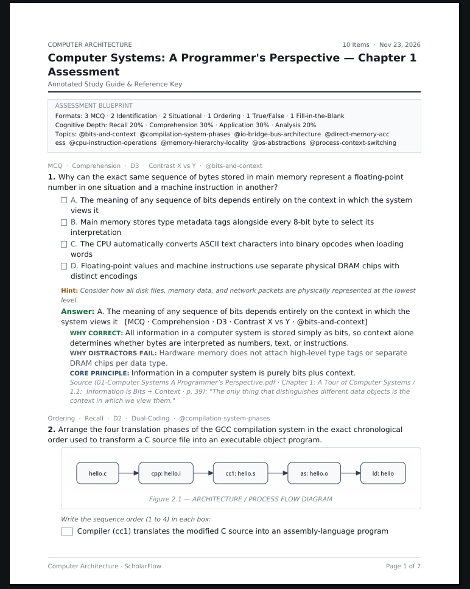<br />
      <sub><b>Printable Study Guide & Exam PDF</b> — Assessment blueprint, structured answer key, verbatim source citations, and embedded diagrams.</sub>
    </td>
  </tr>
</table>

<p align="center">
  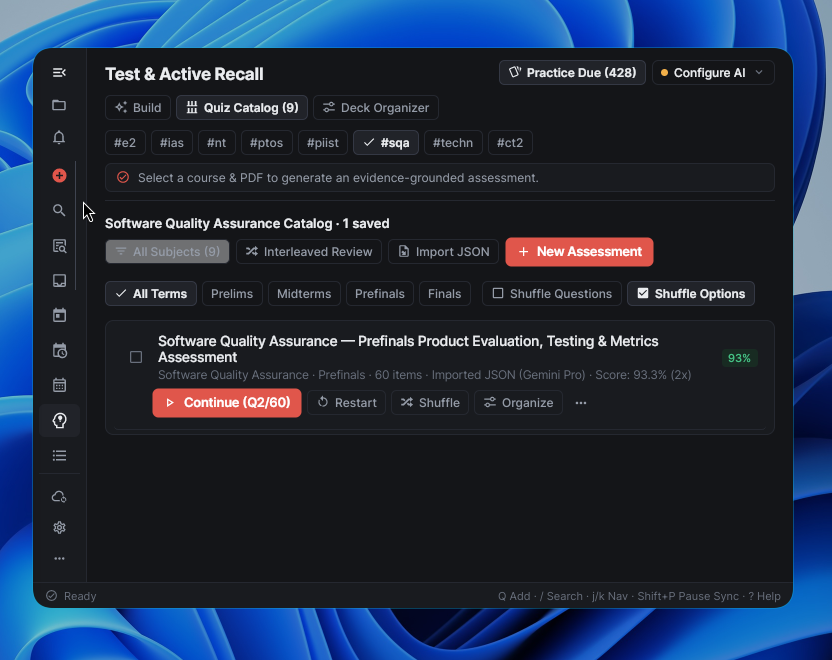<br />
  <sub><b>Quiz Catalog & Deck Organizer</b> — Resume in-progress sessions, run Interleaved Review across subjects, track mastery scores, and switch AI profiles on the fly.</sub>
</p>

---

### 2. Built-in PDF Reader, Page & Section Studio & Visual Snipper
- **High-Performance Continuous Scroll:** Native PDFium `GetPageSizes` (~1–3 ms loads even on 1,100+ page textbooks), progressive 96→180/280 DPI LRU rendering, anchor-preserving `Ctrl+Scroll` / `Ctrl +/-/0` zoom (`40%–350%`), middle-drag pan, rotation, and `Ctrl+F` search.
- **Multi-Highlight Evidence Anchors:** Step through every grounded quote (`#1`, `#2`, `#3`...) with smooth rect-centered jumping.
- **Page & Section Studio & Dedicated Snipper:** Visually scope chapters with heuristic smart section detection, expressive page ranges (`2-5, 8-18, 20-34`), custom saved sections, and an in-place visual PDF snipper.

<table>
  <tr>
    <td width="50%" valign="top">
      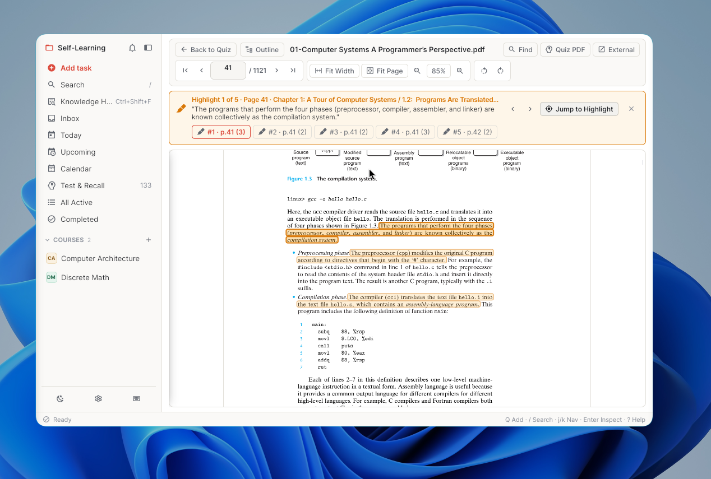<br />
      <sub><b>Built-in PDF Reader</b> — Multi-highlight <code>EvidenceAnchors</code> bar with instant jump-to-highlight on a 1,121-page book.</sub>
    </td>
    <td width="50%" valign="top">
      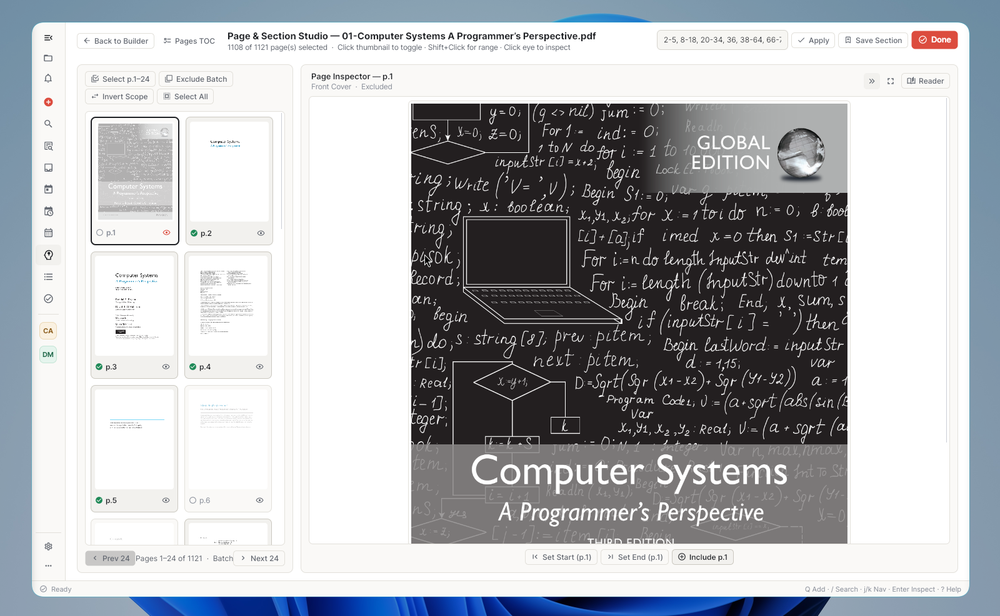<br />
      <sub><b>Page & Section Studio</b> — Thumbnail grid, expressive page-range targeting, custom saved sections, and live Page Inspector.</sub>
    </td>
  </tr>
</table>

---

### 3. Knowledge Hub & Keyboard-First Search
- **Multi-Format Study Sources:** Index and inspect PDFs, syntax-highlighted source code, Markdown notes, plain text, and images in a unified `SourceViewer`.
- **Spotlight Knowledge Search (`Ctrl+Shift+F`):** Filter by format (`PDF`, `Code`, `Notes`, `Text`, `Images`, `Quizzes`, `Weak Spots`) and course (`#course`), jump straight to the matching page/line, or hit `Quiz This`.
- **Global Quick Search (`Ctrl+K`):** Jump anywhere in the workspace using inline filters (`@tasks`, `@courses`, `@quizzes`, `@files`, `@pdf`, `#course`).

<table>
  <tr>
    <td width="50%" valign="top">
      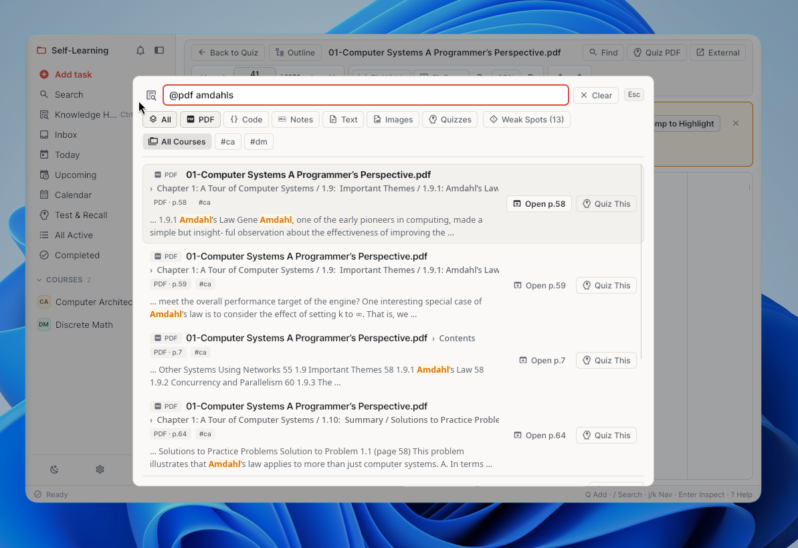<br />
      <sub><b>Knowledge Hub Search (<code>Ctrl+Shift+F</code>)</b> — Ranked SQLite FTS5 snippets with <code>Open p.X</code> and <code>Quiz This</code> actions.</sub>
    </td>
    <td width="50%" valign="top">
      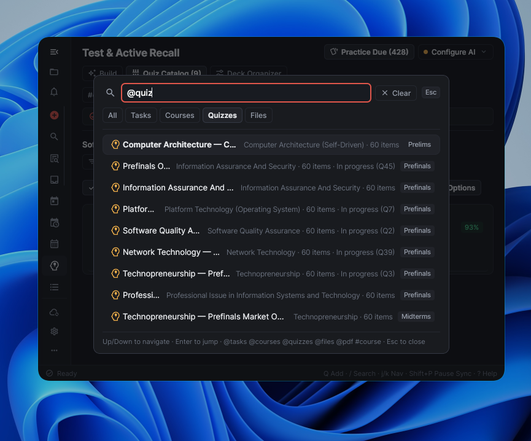<br />
      <sub><b>Quick Search (<code>Ctrl+K</code>)</b> — Instant keyboard navigation with inline <code>@filter</code> and <code>#course</code> tokens.</sub>
    </td>
  </tr>
</table>

---

### 4. Academic Workspace, Calendar & Course Files
- **Smart Task Views & Calendar:** `Inbox`, `Today`, `Upcoming`, `Calendar`, `All Active`, and `Completed`, with term grouping (`Prelims`, `Midterms`, `Prefinals`, `Finals`), nested subtasks, urgency scoring, and a full Task Inspector.
- **Course Files & Study Packets:** Organize course materials with Copy/Move/Symlink import modes, compile multi-format Study Packets, and track instruction/submission attachments with `ongoing/` → `completed/` lifecycle moves.

<p align="center">
  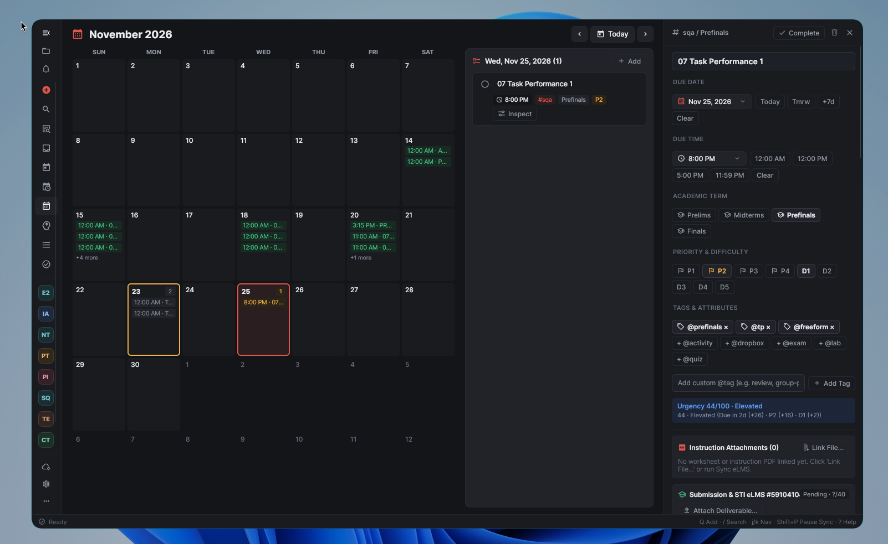<br />
  <sub><b>Calendar & Task Inspector</b> — Month schedule, selected-day agenda, urgency breakdown, tags, and linked LMS submission details.</sub>
</p>

---

### 5. Pluggable LMS Architecture & Model-Agnostic AI
- **Provider-Agnostic LMS SDK (`ScholarFlow.Elms`):** Background polling with manual Pause/Resume (`Shift+P`), automatic pause during active browser sessions, and per-course sync. Ships with **STI eLMS / CYPHER** (`ScholarFlow.Elms.Sti`) and supports custom LMS plugins—see [docs/LMS_PROVIDER_INTEGRATION.md](docs/LMS_PROVIDER_INTEGRATION.md).
- **Flexible AI Profiles:** Built-in presets for **Google AI Studio**, **OpenAI**, **OpenRouter**, **DeepSeek**, **Groq**, **Ollama**, **LM Studio**, **Manual JSON Bridge**, and **Offline PDF Analyzer**.

---

## Quick Install & Uninstall

No git clone or .NET SDK required—downloads the latest self-contained single-file release.

### Linux (`x64`)

**Install:**
```bash
curl -fsSL https://api.github.com/repos/Markism-JA/ScholarFlow/releases/latest | grep -o 'https://[^"]*linux-x64\.tar\.gz' | head -n1 | xargs -I{} sh -c 'd=$(mktemp -d) && curl -fsSL "{}" | tar -xz -C "$d" && "$d/install.sh" && rm -rf "$d"'
```

**Uninstall:**
```bash
curl -fsSL https://raw.githubusercontent.com/Markism-JA/ScholarFlow/master/scripts/uninstall-linux.sh | bash
```

### Windows (`x64` PowerShell)

**Install:**
```powershell
$r = irm https://api.github.com/repos/Markism-JA/ScholarFlow/releases/latest; $u = ($r.assets | ? name -like '*win-x64.zip')[0].browser_download_url; $z = "$env:TEMP\ScholarFlow.zip"; $d = "$env:TEMP\ScholarFlow-install"; irm $u -OutFile $z; Expand-Archive $z $d -Force; & "$d\install.ps1"; Remove-Item $z,$d -Recurse -Force
```

**Uninstall:**
```powershell
irm https://raw.githubusercontent.com/Markism-JA/ScholarFlow/master/scripts/uninstall-windows.ps1 | iex
```

> [!NOTE]
> Uninstalling removes the application binary, Playwright runtime, and desktop/menu shortcuts. Your Study Vault folder (PDFs, notes, and `.scholarflow/scholarflow.db`) is preserved unless you delete it manually.

---

## Architecture

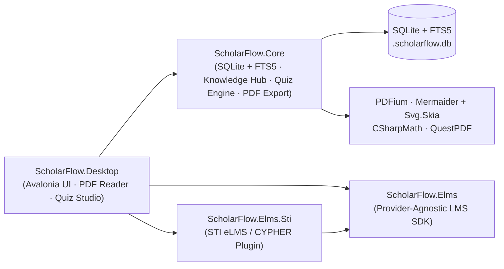

---

## Keyboard Shortcuts

<details>
<summary><strong>View full keyboard shortcut reference</strong></summary>

| Shortcut | Action |
|---|---|
| `1` – `7` | Switch views (`Inbox`, `Today`, `Upcoming`, `Calendar`, `Test & Recall`, `All Active`, `Completed`) |
| `Ctrl+Shift+F` | Open Knowledge Hub Spotlight search (PDFs, code, notes, quizzes, weak spots) |
| `Ctrl+K` or `/` | Open Global Quick Search (`@tasks`, `@courses`, `@quizzes`, `@files`, `@pdf`, `#course`) |
| `Q` | Open Quick Add task modal |
| `S` | Toggle left sidebar |
| `I` / `Enter` | Toggle Task Inspector |
| `j` / `k` or `Up` / `Down` | Navigate task list |
| `Shift+P` | Pause / Resume background LMS sync polling |
| `Ctrl +` / `Ctrl -` / `Ctrl 0` | Zoom in / out / reset in PDF Reader & Snipper |
| `Ctrl+F` (in PDF Reader) | Search inside active PDF |
| `1` – `4` (in Quiz Play) | Select Multiple Choice / Situational option |
| `Left` / `P`, `Right` / `N` | Previous / Next question in Quiz Play |
| `E` (in Quiz Play) | Open floating Quick Edit for current question |
| `?` | Open Keyboard Shortcuts overlay |
| `Esc` | Close active modal, popover, or drawer |

</details>

---

## Build from Source & Development

<details>
<summary><strong>Clone, build, test, and publish self-contained binaries</strong></summary>

Requires the **.NET 10 SDK**.

```bash
git clone https://github.com/Markism-JA/ScholarFlow.git
cd ScholarFlow
```

### Run from Source
```bash
dotnet run --project src/ScholarFlow.Desktop/ScholarFlow.Desktop.csproj
```

### Build & Run Test Suite
```bash
dotnet build ScholarFlow.slnx --disable-build-servers -m:1
dotnet test ScholarFlow.slnx --no-build --disable-build-servers
```

### Publish Release Binaries (`linux-x64` & `win-x64`)
```bash
./scripts/publish.sh v1.3.0
```
Outputs verified self-contained single-file builds and archives to `dist/`:
- `dist/linux-x64/` & `dist/ScholarFlow-v1.3.0-linux-x64.tar.gz`
- `dist/win-x64/` & `dist/ScholarFlow-v1.3.0-win-x64.zip`

### Install / Uninstall from a Local Clone

**Linux:**
```bash
./scripts/install-linux.sh
# Uninstall:
./scripts/uninstall-linux.sh
```
Installs to `~/.local/share/scholarflow/`, symlinks `~/.local/bin/ScholarFlow`, and registers the desktop entry & SVG icon under `~/.local/share/`.

**Windows (PowerShell):**
```powershell
powershell -ExecutionPolicy Bypass -File .\scripts\install-windows.ps1
# Uninstall:
powershell -ExecutionPolicy Bypass -File .\scripts\uninstall-windows.ps1
```
Installs to `%LOCALAPPDATA%\Programs\ScholarFlow\`, adds it to User `PATH`, and creates Start Menu and Desktop shortcuts.

</details>
